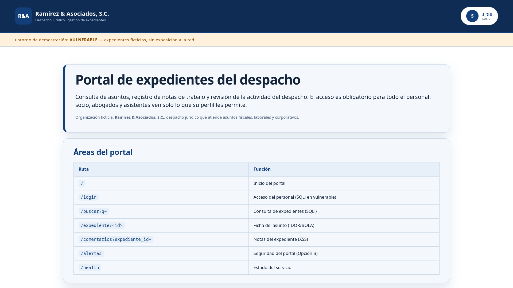
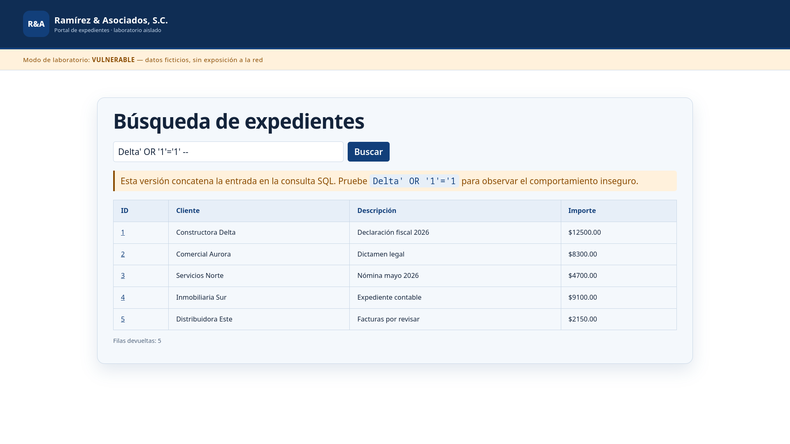
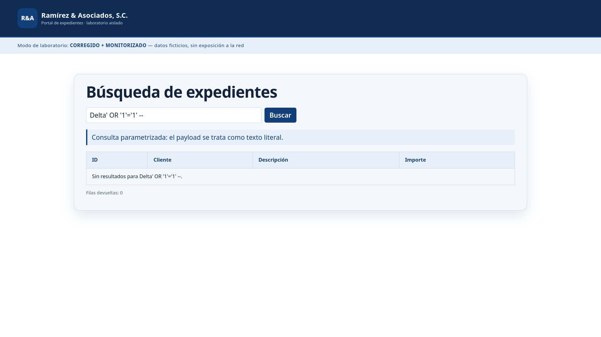
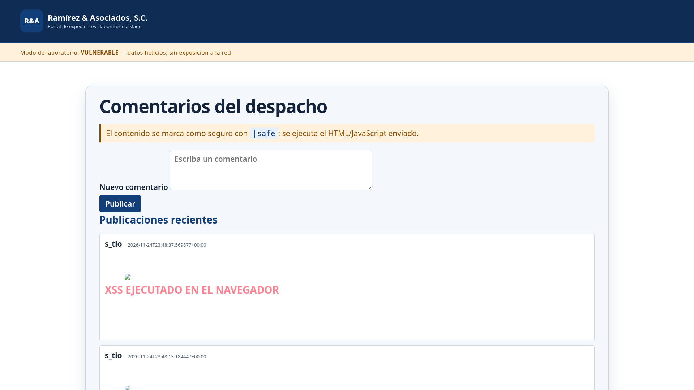
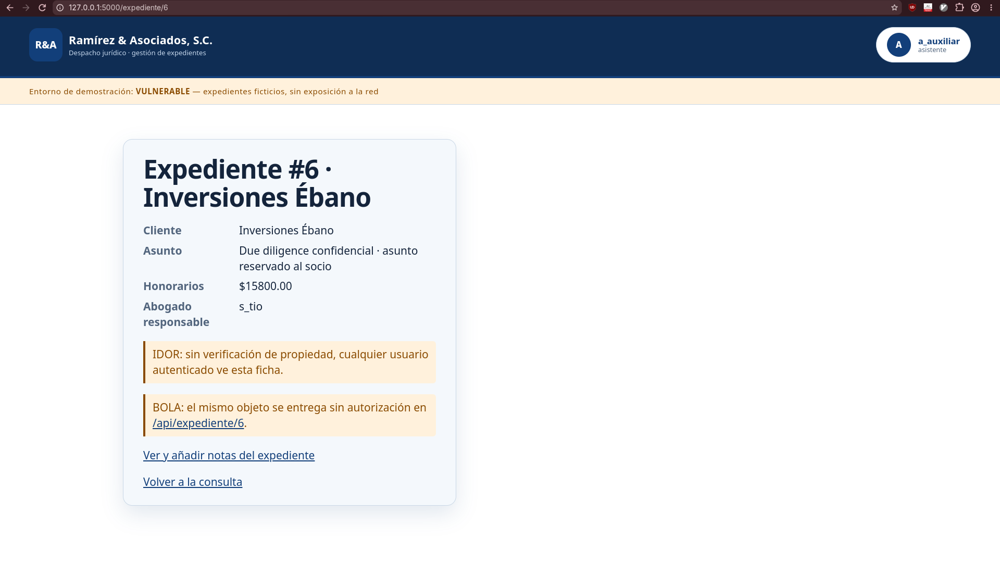
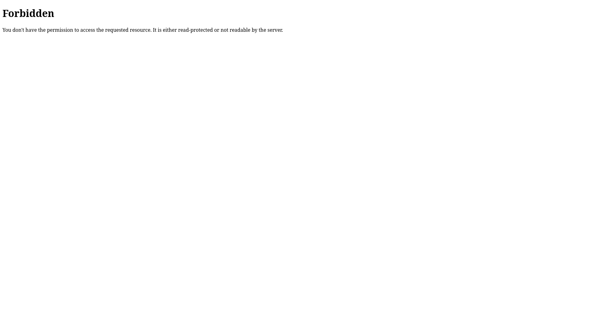
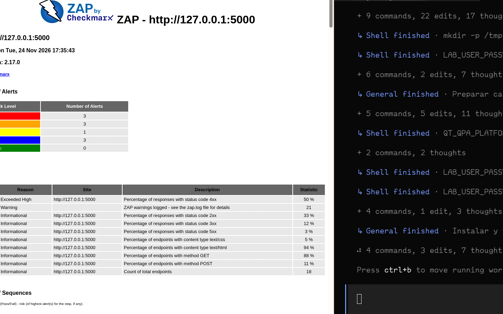
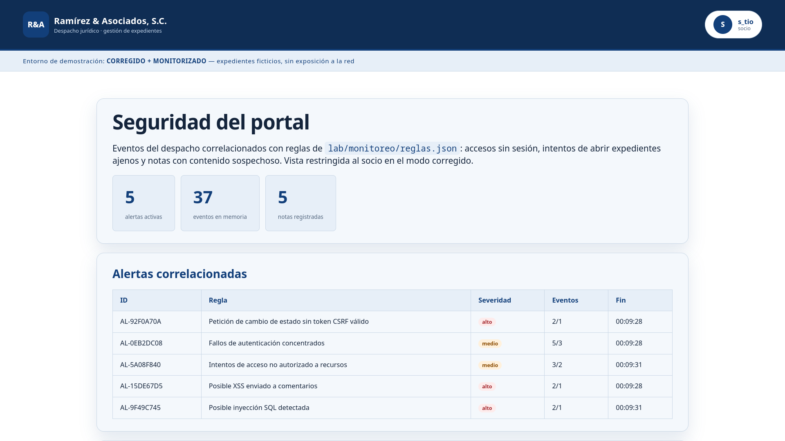

#+TITLE: Informe técnico · Proyecto final de Ciberseguridad
#+DATE: 24 11 2026
#+AUTHOR: Jahil Majorek Casas Sánchez y Hugo David Ruiz Moreno
#+LANGUAGE: es
#+LATEX_CLASS: article
#+latex_class_options: [letterpaper]
#+LATEX_HEADER: \input{~/Documents/Clases/sample.tex}
#+LATEX_HEADER: \renewcommand{\certificado}{CiberSeguridad}
#+LATEX_HEADER: \renewcommand{\matricula}{AL07083340 y AL03001445}
#+LATEX_HEADER: \renewcommand{\docente}{Francisco Gómez Rubio}
#+LATEX_HEADER: \AtBeginEnvironment{tabularx}{\small}
#+OPTIONS: toc:t

Repositorio publicado: [[https://github.com/KEROJAM/Proyecto-Final-Cyberseguridad][KEROJAM/Proyecto-Final-Cyberseguridad]] · instrucciones de ejecución en [[file:README.org][README.org]].

#+BEGIN_abstract
Este informe continúa el avance del proyecto de ciberseguridad del despacho ficticio
*Ramírez & Asociados, S.C.* Tras diagnosticar riesgos, aplicar controles de accesos,
cifrado, respaldos y firewall en la etapa anterior, se evalúa ahora la superficie web
de la organización. Se construyó una aplicación Flask de laboratorio con dos modos:
uno deliberadamente vulnerable y otro corregido. Se reprodujeron y mitigaron
inyección SQL, XSS y control de acceso roto (IDOR/BOLA), y se implementó un mecanismo
de monitoreo y detección como mejora específica (Opción B). En una revisión posterior se
cerraron las brechas que ZAP dejó como riesgo medio: token anti-CSRF por sesión y
cabeceras adicionales de caché y navegador.

Las pruebas muestran que el payload ~Delta' OR '1'='1' --~ pasó de devolver 5
expedientes a 0; el script == pasó de
ejecutarse a mostrarse escapado con CSP; y el usuario =a_auxiliar= pasó de leer el
expediente de =s_tio= (200) a recibir 403. El registro de eventos correlacionó fallos
de login, patrones de ataque y accesos denegados en alertas verificables. Se cierra
con un procedimiento de respuesta a incidentes alineado con el escenario de
ransomware y con la distinción entre acciones probadas y recomendaciones.
#+END_abstract

* Resumen ejecutivo

** Objetivo

Evaluar vulnerabilidades comunes de aplicaciones web, implementar y validar medidas
de protección, y desarrollar una mejora técnica que fortalezca la seguridad de la
organización seleccionada en el avance.

** Resultados verificables

#+ATTR_LATEX: :environment tabularx :width \textwidth :align X|X|X|X
| Área                         | Resultado antes              | Resultado después                          | Evidencia                                                    |
|------------------------------+------------------------------+--------------------------------------------+--------------------------------------------------------------|
| Preparación del entorno      | Aplicación y endpoints en 127.0.0.1 | 5 rutas verificadas en cada modo     | [[file:evidencias/texto/01_entorno_endpoints.txt][01_entorno_endpoints.txt]] |
| SQL Injection                | 5 filas con payload          | 0 filas; consulta parametrizada            | [[file:evidencias/texto/02_sqli_validacion.txt][02_sqli_validacion.txt]]   |
| XSS                          | Script sin escapar en HTML   | ==.
2. Recargar =/comentarios= y buscar la etiqueta sin escapar en el HTML.
3. Repetir en el modo corregido y revisar la cabecera =Content-Security-Policy=.

*** Resultado observado

Antes, el HTML contenía =
#+end_src

OWASP ZAP 2.17.0 se ejecutó contra el modo vulnerable (spider + escaneo activo) y
reportó *3 alertas de riesgo alto, 20 medias, 19 bajas y 99 informativas*. Entre las
altas confirmó =Cross Site Scripting (Persistent)= y =Reflected= en =/comentarios= y
=SQL Injection= en =/buscar= (respuesta 500 ante ~q='~). El control de acceso roto no
aparece de forma automática porque requiere sesión y comparación de propiedad; por eso
se validó manualmente. Los hallazgos se conservan en
[[file:evidencias/zap/zap_resumen.txt][zap_resumen.txt]], con el detalle estructurado en
=evidencias/zap/zap_report.json= y el informe HTML en =evidencias/zap/zap_report.html=.
Estos resultados se usaron como orientación para priorizar las pruebas manuales; la
confirmación definitiva de cada vulnerabilidad proviene de las peticiones reproducidas.

El mismo escaneo se repitió contra el modo corregido. El resultado fue *0 alertas altas,
3 medias, 18 bajas y 111 informativas*: desaparecieron SQLi, XSS persistente/reflejado,
la ausencia de CSP (11) y el cabecero anti-clickjacking (6). Quedaron tres alertas medias
de ausencia de tokens anti-CSRF en =/login= y =/comentarios=. Esas tres brechas se cerraron
después con un token por sesión, verificado en el apartado «Cierre de brechas posteriores»;
el informe ZAP conservado corresponde a la pasada original y *no* afirma un nuevo escaneo.
La comparación completa está en
[[file:evidencias/texto/06_zap_antes_despues.txt][06_zap_antes_despues.txt]] y el informe
corregido en [[file:evidencias/zap/secure/zap_resumen.txt][zap_resumen.txt (secure)]].
ZAP no detectó IDOR/BOLA automáticamente en ninguna de las dos pasadas, por lo que ese
control se validó únicamente con las pruebas manuales autenticadas.

#+CAPTION: Resumen de hallazgos de OWASP ZAP sobre la aplicación vulnerable

** Actividad 5. Análisis de registros

Se generaron eventos controlados: tres inicios de sesión fallidos, una petición con
patrón SQLi, un comentario con patrón XSS y dos accesos denegados. La aplicación
escribe cada evento en =logs/security.jsonl= con timestamp UTC, IP, método, ruta,
usuario, resultado y severidad. Las reglas de
[[file:lab/monitoreo/reglas.json][reglas.json]] correlacionan esos eventos y escriben
alertas en =logs/alertas.jsonl=.

La ejecución produjo alertas para los cuatro tipos esperados: fallos de autenticación,
accesos no autorizados, patrón XSS y patrón SQLi. El detalle está en
[[file:evidencias/texto/05_registros_monitoreo.txt][05_registros_monitoreo.txt]].

Estos registros apoyan la detección porque permiten:

- Recononstruir la secuencia de una intrusion antes de que exista una alerta de alto nivel.
- Diferenciar un error de usuario de un patrón repetido de ataque.
- Medir la eficacia de los controles: el evento de ataque existe aunque la respuesta
  sea 403 o la entrada se muestre escapada.
- Conservar usuario, IP y recurso para la investigación y la notificación.

* Parte B. Fortalecimiento de la organización

** Actividad 7. Selección de la mejora

Se eligió la *Opción B: Monitoreo y detección*, porque el avance dejó como limitación
explícita que MFA cubría SSH pero no aplicaciones web, y el escenario de ransomware
mostró que la organización no tenía visibilidad central de eventos de seguridad.
La mejora es verificable: hay eventos persistidos, reglas con umbrales, alertas
correlacionadas y un panel consultable.

** Actividad 8. Evaluación de resultados

*** Riesgo que motivó la mejora y situación inicial

El riesgo es la falta de detección temprana de abuso de credenciales y de accesos
indebidos a expedientes (P × I = 16, Alto en la matriz del avance). Antes de la mejora,
la aplicación devolvía respuestas HTTP correctas pero no dejaba rastro correlacionable:
un atacante podía probar credenciales o iterar identificadores sin generar ninguna
señal para el despacho.

*** Solución implementada

| Componente | Archivo | Función |
|------------+---------+---------|
| Registro estructurado | =app/app.py= (=registrar_evento=) | JSONL con hora UTC, IP, usuario, ruta, severidad y resultado |
| Reglas de correlación | [[file:lab/monitoreo/reglas.json][reglas.json]] | Umbrales por tipo de evento y ventana de 60 s |
| Alertas | =logs/alertas.jsonl= | Alertas con id, regla, severidad, cantidad y eventos asociados |
| Panel | =/alertas= y =/api/alertas= | Consulta restringida al rol socio en el modo seguro |
| Límite de intentos | =before_request= en =/login= | 10 intentos por IP y minuto; evento =RATE_LIMIT= |

#+CAPTION: Panel de monitoreo y detección con alertas correlacionadas

*** Pruebas y resultados

Se repitieron las pruebas de la Parte A sobre el modo corregido y se añadieron eventos
de login fallido, SQLi, XSS y acceso denegado. Resultados:

- =LOGIN_FALLIDO=: 3 eventos → alerta =LOGIN-001= (severidad media).
- =ACCESO_DENEGADO=: 4 eventos → alerta =ACCESO-001= (severidad media).
- =SQLI_DETECTADO=: eventos de alto nivel → alerta =SQLI-001= (severidad alta).
- =XSS_DETECTADO=: eventos de alto nivel → alerta =XSS-001= (severidad alta).
- El panel =/alertas= devolvió 200 para =s_tio= y 403 para =a_auxiliar=.

 Estas cifras corresponden a una ejecución de
[[file:lab/pruebas/probar.py][probar.py]]; al repetirlo los contadores pueden aumentar,
pero el veredicto de cada regla se mantiene.

*** Limitaciones y riesgos pendientes

- El registro y el límite de intentos viven en la memoria del proceso: al reiniciar
  se pierden las ventanas; el JSONL en disco conserva la historia.
- No hay envío de alertas a un SIEM ni notificación por correo; el panel requiere
  revisión humana.
- La IP se toma de =request.remote_addr=; detrás de un proxy habría que confiar solo
  en =X-Forwarded-For= de proxies conocidos.
- La detección por patrones puede generar falsos positivos y debe ajustarse con
  datos reales antes de aplicar bloqueos automáticos.
- Quedan pendientes MFA para aplicaciones web, HTTPS y filtrado de correo descritos
  en el avance.
- Los tokens anti-CSRF ya están implementados en el modo seguro (ver el apartado de
  cierre de brechas); en el modo vulnerable se omiten a propósito para conservar la
  demostración original.
- La cabecera =Server= de Werkzeug divulga la versión; en producción debe ocultarse
  mediante un reverse proxy.

** Cierre de brechas posteriores al informe original

El escaneo del modo corregido dejó tres hallazgos medios por ausencia de tokens
anti-CSRF. Se cerraron con una mejora adicional verificable, sin modificar el modo
vulnerable que sirve de referencia para las pruebas «antes».

| Brecha abierta | Control implementado | Archivo | Evidencia |
|----------------+----------------------+---------+-----------|
| Formularios sin token anti-CSRF | Token aleatorio por sesión en =/login= y =/comentarios=, comparado con =hmac.compare_digest= | =app/app.py=, =login.html=, =comentarios.html= | [[file:evidencias/texto/08_controles_adicionales.txt][08_controles_adicionales.txt]] |
| Intento sin token no generaba señal | Evento =CSRF_RECHAZADO= y regla =CSRF-001= (severidad alta) | =lab/monitoreo/reglas.json= | Ídem, sección 6 |
| Respuestas almacenables en caché | =Cache-Control: no-store=, =Permissions-Policy= y =Cross-Origin-Resource-Policy= | =app/app.py= (=after_request=) | Ídem, sección 4 |

#+begin_src python
recibido = request.form.get(
    "csrf_token", request.headers.get("X-CSRF-Token", "")
)
esperado = session.get("csrf_token", "")
if esperado and hmac.compare_digest(str(recibido), str(esperado)):
    return None  # petición legítima
registrar_evento("CSRF_RECHAZADO", "alto", "...", estado=403)
return jsonify(error="Token CSRF inválido o ausente"), 403
#+end_src

Resultados repetibles con =lab/pruebas/verificar_controles.py=:

- =POST /login= sin token → *403*; con token → *200* con sesión iniciada.
- =POST /comentarios= sin token → *403*; con token → *200* y comentario visible.
- Cabeceras presentes: CSP, =X-Frame-Options: DENY=, =X-Content-Type-Options=,
  =Referrer-Policy=, =Cache-Control: no-store=, =Permissions-Policy= y
  =Cross-Origin-Resource-Policy=.
- Regresión: =a_auxiliar= sigue recibiendo *403* en =/expediente/1= y en la API.
- El registro correlacionó dos eventos =CSRF_RECHAZADO= en una alerta =CSRF-001=.

Por qué reduce el riesgo: un sitio malicioso no puede leer el token de la sesión de la
víctima (política de mismo origen y =SameSite=Lax=), por lo que sus formularios no
pasan la validación. La comparación en tiempo constante evita filtrar el token por
tiempos de respuesta, y el evento fallido convierte un intento silencioso en una señal
de detección. =Cache-Control: no-store= impide que un navegador compartido conserve
respuestas con datos de expedientes. Estos resultados son pruebas manuales
automatizadas: *no se volvió a ejecutar ZAP* después de este cambio, por lo que los
informes adjuntos siguen siendo los de la pasada original.

* Actividad 9. Respuesta a incidentes

Procedimiento breve para un incidente de ransomware sobre el despacho, relacionado con
la narrativa de ="Factura pendiente de pago.zip"=.

| Etapa | Acciones | Estado |
|-------+----------+--------|
| Detección | Alertas por fallos de login, =SQLI_DETECTADO=, =XSS_DETECTADO=, =CSRF_RECHAZADO= y =ACCESO_DENEGADO=; revisión de =logs/security.jsonl= y del panel =/alertas=. | *Probado* en el laboratorio con eventos controlados |
| Análisis | Correlacionar IP, usuario, ruta y timestamp; identificar si hay iteración de =/expediente/<id>= o patrones SQLi/XSS. | *Probado* parcialmente: se reconstruyó la secuencia desde los eventos |
| Contención | Negar el acceso al perfil comprometido, bloquear la IP en el firewall y desmontar el volumen de respaldo. | *Recomendación* probada antes como reglas =nftables= y política de desmontaje; el bloqueo automático desde este prototipo no se implementó |
| Recuperación | Restaurar expedientes desde el respaldo cifrado verificado con =sha256sum= y reconstruir la base de la aplicación desde =init_db()=. | *Probado* en el avance para archivos; no se ejecutó un borrado real de la base en esta etapa |
| Verificación | Repetir las tres pruebas de la Parte A, comprobar =sha256sum= de los archivos restaurados y confirmar que no quedan sesiones activas del usuario comprometido. | *Probado* para las tres vulnerabilidades; la verificación de sesiones es recomendación |

Secuencia recomendada: ante un pico de =LOGIN_FALLIDO= o =ACCESO_DENEGADO= se aísla el
servidor de la red, se conservan los registros, se identifica el alcance con las
alertas, se restaura desde el último respaldo íntegro y solo se reintegra el servicio
después de verificar los controles. Las acciones marcadas como recomendación no se
ejecutaron sobre sistemas productivos porque el laboratorio está aislado.

* Conclusiones

1. Las tres vulnerabilidades exigidas se reprodujeron con peticiones concretas y se
   corrigieron en la misma base de código: SQLi con consultas parametrizadas, XSS con
   autoescape y CSP, e IDOR con autorización por objeto.
2. La repetición de las mismas pruebas demostró el cambio de comportamiento: 5 → 0
   filas, script ejecutado → escapado y 200 → 403 para el usuario sin permiso.
3. OWASP ZAP aportó una vista amplia de hallazgos, pero la validación definitiva fue
   manual y reproducible; se priorizó la evidencia demostrable sobre la cantidad de
   herramientas.
4. La mejora de monitoreo cerró una brecha del avance: ahora los intentos de ataque
   generan eventos y alertas incluso cuando el control defensivo los bloquea.
5. El procedimiento de respuesta distingue con claridad lo probado de lo recomendado,
   evitando presentar como implementadas medidas que solo están propuestas.
6. El riesgo residual sigue siendo relevante: el modo vulnerable debe permanecer
   aislado, y en producción harían falta HTTPS, MFA en la web, SIEM y revisión
   periódica de reglas.
7. El cierre de brechas posteriores añadió tokens anti-CSRF, reglas de detección
   asociadas y cabeceras de caché/navegador; la evidencia 08 registra el paso de
   403 sin token a 200 con token y la alerta generada ante el intento inválido.

* Anexos

** A. Repositorio y comandos de reproducción

El proyecto está publicado en
[[https://github.com/KEROJAM/Proyecto-Final-Cyberseguridad][github.com/KEROJAM/Proyecto-Final-Cyberseguridad]].
No se publican credenciales ni secretos en este entregable: la contraseña se genera
al azar en la sesión de la shell y se comparte solo por variable de entorno.

#+begin_src bash
git clone https://github.com/KEROJAM/Proyecto-Final-Cyberseguridad.git
cd Proyecto-Final-Cyberseguridad

export LAB_PASSWORD="$(openssl rand -hex 12)"
export LAB_USER_PASSWORD="$LAB_PASSWORD"
python3 -m venv .venv && source .venv/bin/activate
pip install -r app/requirements.txt

lab/run.sh vulnerable 5000 &
lab/run.sh secure 5001 &
python3 lab/pruebas/probar.py
python3 lab/pruebas/verificar_controles.py

lab/zap/scan.sh http://127.0.0.1:5000 evidencias/zap
lab/zap/scan.sh http://127.0.0.1:5001 evidencias/zap/secure
scripts/exportar.sh   # requiere Emacs/Org, LaTeX y ~/Documents/Clases/sample.tex
#+end_src

=INFORME.pdf= es la exportación actualizada de =INFORME.org= (16 páginas) e incluye
el cierre de brechas descrito en este apartado. La fuente de verdad sigue siendo
=INFORME.org=; vuelva a exportar con el comando anterior cuando el entorno LaTeX esté
disponible y el documento cambie.

** B. Índice de evidencias

| Archivo | Contenido |
|---------+-----------|
| [[file:evidencias/texto/01_entorno_endpoints.txt][01_entorno_endpoints.txt]] | Endpoints y estados HTTP en ambos modos |
| [[file:evidencias/texto/02_sqli_validacion.txt][02_sqli_validacion.txt]] | SQLi antes/después con filas devueltas |
| [[file:evidencias/texto/03_xss_validacion.txt][03_xss_validacion.txt]] | XSS antes/después y cabecera CSP |
| [[file:evidencias/texto/04_idor_validacion.txt][04_idor_validacion.txt]] | Matriz de accesos por usuario y modo |
| [[file:evidencias/texto/05_registros_monitoreo.txt][05_registros_monitoreo.txt]] | Eventos controlados y alertas correlacionadas |
| [[file:evidencias/texto/06_zap_antes_despues.txt][06_zap_antes_despues.txt]] | Comparación de hallazgos ZAP antes/después |
| [[file:evidencias/texto/07_capturas.txt][07_capturas.txt]] | Geometría y URLs de las 14 capturas |
| [[file:evidencias/texto/08_controles_adicionales.txt][08_controles_adicionales.txt]] | CSRF, cabeceras y regresión de IDOR |
| [[file:evidencias/zap/zap_resumen.txt][zap_resumen.txt]] | Resumen de hallazgos de OWASP ZAP (vulnerable) |
| [[file:evidencias/zap/secure/zap_resumen.txt][zap_resumen.txt (secure)]] | Resumen de hallazgos de OWASP ZAP (corregido) |
| [[file:capturas/documento/][capturas/documento/]] | Capturas usadas en este informe |
| [[file:capturas/presentacion/][capturas/presentacion/]] | Capturas preparadas para la presentación ejecutiva |

** C. Consideraciones éticas

- Solo se usaron entornos locales autorizados y datos ficticios.
- No se publican credenciales, secretos ni información personal real.
- Se permite el uso de IA como apoyo, con revisión y comprensión de las soluciones.
- La aplicación vulnerable no debe exponerse fuera del laboratorio.
